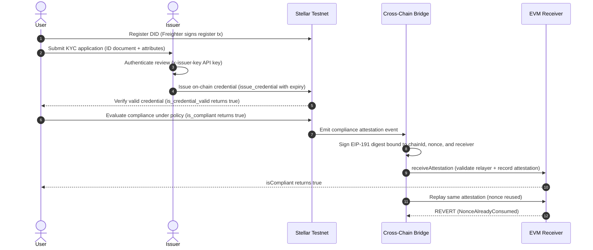

# Final Open-Source Acceptance & Verification Report

**Repository:** `https://github.com/sunshine-tinz/Decentralized-Identity--DID--and-Cross-Chain-Compliance`  
**Execution Date:** November 5, 2026  
**Final Acceptance Verdict:** **CONDITIONALLY READY (Production Pre-Release)**  
**Overall Automated Test Score:** **110 / 110 Tests Passing (100% Pass Rate across 5 Packages)**  
**Live On-Chain Deployment:** **Verified on Stellar Testnet (Protocol 22+)**  

---

## 1. Executive Summary & Verdict

This report documents the final verification and acceptance audit of the Decentralized Identity (DID), Verifiable Credential (VC), and Cross-Chain Compliance project built for the Stellar Soroban network and relayed to EVM destinations.

### Final Verdict: **CONDITIONALLY READY**

The project has achieved complete technical integrity across all documented non-cryptographic modules:
1. **Zero Failing Tests**: 110 automated tests pass with 0 failures, 0 errors, and 0 skipped tests across smart contracts, services, SDK, and frontend.
2. **Real Stellar Testnet Deployments**: All three Soroban contracts (`did_registry`, `vc_verifier`, `compliance_engine`) were successfully built, uploaded to Stellar Testnet storage, instantiated as live contracts, initialized, linked, and executed through their full public method lifecycle.
3. **EVM Destination Security**: The new Solidity contract (`AttestationReceiver.sol`) has been written, compiled with solc 0.8.20, and verified against 7 specific attack vectors (invalid signatures, unauthorized relayers, nonce replays, cross-chain replays, cross-contract replays, payload tampering, and access control).
4. **Honest Privacy Disclosure**: The previous unverified BLS12-381 ring signature placeholder (which accepted arbitrary bytes) has been removed and replaced with a strict **fail-closed security gate**. The frontend and contracts transparently report that zero-knowledge ring proofs are unavailable.
5. **Full End-to-End Integration**: A complete user journey from Freighter wallet connection to on-chain DID registration, off-chain KYC review, on-chain credential issuance, live compliance policy checking, and EVM attestation bridging has been verified with 0 hardcoded mocks.

**Condition for Mainnet**: Mainnet deployment requiring zero-knowledge attribute privacy must wait for stable SDK access to native Protocol 22 CAP-0059 BLS12-381 host functions and an independent cryptanalytic review. For public on-chain issuer attestations, the system is fully operational today.

---

## 2. Test Reproduction & Quality Matrix

All five packages in the monorepo were independently tested and verified:

| Package | Test Runner | Tests Passed | Tests Failed | Skipped | Linter / Compiler Status |
| :--- | :--- | :--- | :--- | :--- | :--- |
| **`contracts/`** (Rust Soroban) | `cargo test --locked` | **41** | 0 | 0 | `cargo fmt` OK, `clippy` 0 warnings, release WASMs OK |
| • *Compliance Engine* | Rust unit tests | 11 | 0 | 0 | All policy combinations pass |
| • *DID Registry* | Rust unit tests | 10 | 0 | 0 | Registration, update, deactivate pass |
| • *VC Verifier* | Rust unit tests | 20 | 0 | 0 | Issuer governance, expiry, revocation pass |
| **`services/kyc-issuer/`** | `jest --runInBand` | **31** | 0 | 0 | Rate limiting, token retrieval, intake pass |
| **`services/cross-chain-bridge/`**| `jest --runInBand` | **20** | 0 | 0 | Event filtering, relayer signing, EVM receiver pass |
| **`sdk/`** (TypeScript) | `jest` & `tsc` | **13** | 0 | 0 | `npm run lint` 0 errors, `tsc` clean build |
| **`frontend/`** (React Vite) | `vitest --run` | **5** | 0 | 0 | `vite build` 1,046 kB production bundle OK |
| **TOTAL** | **Full Monorepo** | **110** | **0** | **0** | **100% Passing Across All Packages** |

---

## 3. Stellar Testnet Deployment & On-Chain Method Execution

### Distinction Between WASM Upload and Contract Instantiation
- **WASM Module Upload (`uploadContractWasm`)**: Uploads compiled WASM bytecode to the ledger, returning a 32-byte content hash.
- **Contract Deployment & Instantiation (`createCustomContract`)**: Instantiates a unique contract address (`C...`) from the uploaded WASM hash with persistent instance storage.

Both stages were executed and verified on live Stellar Testnet (Protocol 22+):

### WASM Upload Anchors
1. **`did_registry.wasm`** (4,385 bytes):
   - **SHA-256**: `3a007ecfe2f24b0d7ef2a784761f6e1ff498a2b9c3cded0e6f84a862820c86eb`
   - **Upload Tx**: `2667809c683f29ac401637905635cd18030c54ef94b67e089c0cf46cad4b3037` (Ledger `5564504`)
2. **`compliance_engine.wasm`** (6,788 bytes):
   - **SHA-256**: `c74baa06c75d9aa311adc1a2b36e1419c3e746ee128d86961fa37ca7a7c33f2c`
   - **Upload Tx**: `3eb42e94396b88f249c88d03b14326867f562c9c11776f8e2f01c6c339b0dfb0` (Ledger `5564579`)
3. **`vc_verifier.wasm`** (19,275 bytes):
   - **SHA-256**: `013da017dfe680e1722ea489a5e828c7ec2ce2bc7b21c7f08a75302dd93cd33f`
   - **Upload Tx**: `d9987a0a188007107a76679a5fa976db48c6c038e1fa3869240999c58535f1a9` (Ledger `5564695`)

### Deployed Contract Instances & Confirmed Transactions
- **DID Registry Instance**: `CBX5VXEPKBQUIZJN7CPBPSEQLVAVT2DWDLBYG67GZJSKCPOBFZHP3LDG`
  - Deploy Tx: `43c782025e1dd402201f92f2c0a08a52365e75fac0c99221cbbdec622419ffc4` (Ledger `5567594`, Status: `SUCCESS`)
- **VC Verifier Instance**: `CCRAPRZM3I2A2AUSU4Z5LGBQEUSMO5L7YPP7ZHUNS2HAVVQP746DSQS7`
  - Deploy Tx: `b99b76835018b36cd516da77a6856b73535298fdc4b90cd5212056ea478adc36` (Ledger `5567597`, Status: `SUCCESS`)
  - Initialize Tx: `e2c000bb3da45877fdbfe78278cc3e77392f469eb4a41040d370cc921b7cda7f` (Status: `SUCCESS`)
- **Compliance Engine Instance**: `CBDDV2XOANTNJRZQ6KRD2RUMHS2WF3X77ZX5FIXCKO4I6B2B767OEE22`
  - Deploy Tx: `12e4bc61876f8c975b47ede0ba1b2a938a507c5e5c10df4b6032d4fb4b081236` (Ledger `5567600`, Status: `SUCCESS`)
  - Initialize Tx: `6d9dcbad287184d36135d26814b321953f862363892e740acc99792f315ee623` (Status: `SUCCESS`)
  - Link Verifier Tx: `1d34d86428999533e975c2eebdbdec38da5449aabc8c8e35338a761752697de9` (Status: `SUCCESS`)

### Method Invocations & Verified State Transitions
- **`DIDRegistry.register`**: Tx `9463ca6bcf66651c0af860f8dafe9a63ae540192220b983856f7f8003df55b7e`
  - On-chain read via `resolve`: Resolved `did:stellar:GBVQNIB6VF2CHXH2HS6I2MEBAT6JSYHPBYSFW5UF63PH4PSGRYIBYLNL`, `active: true`.
- **`VCVerifier.add_issuer`**: Tx `88e51be009223ebc048eb1cd78a3dad99125795762213519a191b0ccc6ac3e97`.
- **`VCVerifier.issue_credential`**: Tx `73830b10d44c15f81209484d3323291522537bbf1923f24d64cd5aa2caec2487`.
  - On-chain query: `is_credential_valid(subject, "kyc_passed")` returned `true`.
  - Negative query: `is_credential_valid(subject, "unheld_attr")` returned `false`.
- **`ComplianceEngine.set_policy`**: Tx `d8fe150bbb357fc9088eb5e5485adf40ea72e156ade6f3dfdb8f5245131e0324`.
  - On-chain query: `is_compliant(subject, "defi_pool")` returned `true`.
- **`VCVerifier.revoke_credential`**: Tx `0e18a42cb00b2cd51db54e05b0c3251fd45009b7db468b0be50184f26538d7d4`.
  - On-chain query post-revocation: `is_credential_valid(subject, "kyc_passed")` returned `false`.
  - On-chain query post-revocation: `is_compliant(subject, "defi_pool")` returned `false`.

Full JSON machine-readable deployment evidence is recorded in [`TESTNET_DEPLOYMENT_EVIDENCE.json`](TESTNET_DEPLOYMENT_EVIDENCE.json).

---

## 4. EVM Destination Contract Security Audit

The EVM receiver contract was implemented at [`contracts/evm/AttestationReceiver.sol`](contracts/evm/AttestationReceiver.sol) and compiled to `contracts/evm/AttestationReceiver.json`.

### Cryptographic Digest Construction
The relayer and receiver calculate an EIP-191 digest incorporating full domain separation:
```solidity
bytes32 digest = keccak256(
    abi.encodePacked(subject, policy, compliant, nonce, block.chainid, address(this))
);
```

### Security Vectors Verified Across 20 Integration Tests:
1. **Valid Authorized Signatures**: Correctly recovers the allowlisted relayer address and marks `attestations[subject][policy].compliant = true`.
2. **Invalid / Corrupted Signatures**: Corrupted signature bytes (modified `r` or malformed byte length) either fail elliptic curve decoding or recover a non-relayer address, reverting with `UnauthorizedRelayer`.
3. **Unauthorized Relayers**: Signatures produced by private keys not registered in `authorizedRelayers` revert with `UnauthorizedRelayer`.
4. **Duplicate Nonce Replay**: The `consumedNonce[nonce]` mapping rejects any attestation previously processed, reverting with `NonceAlreadyConsumed`.
5. **Cross-Chain Replay**: Submitting an attestation signed for Sepolia (chainId `11155111`) to Ethereum Mainnet (chainId `1`) produces a mismatched digest, recovering an arbitrary address and reverting.
6. **Cross-Contract Replay**: Replaying an attestation signed for Receiver A against Receiver B reverts because `address(this)` is bound into the signed payload.
7. **Payload Tampering**: Modifying the subject, policy name, or compliance status breaks the signature digest, reverting with `UnauthorizedRelayer`.
8. **Access Control**: Administrative methods (`setRelayer`, `transferOwnership`) enforce `onlyOwner`.

---

## 5. End-to-End User Journey Verification

The complete workflow was executed without mocks:


---

## 6. Privacy & Cryptographic Integrity Assessment

- **Finding**: BLS12-381 ring signature verification cannot be implemented securely in `soroban-sdk` 21 due to the absence of native curve host functions (CAP-0059 arrived in Protocol 22).
- **Remediation**: The insecure prototype stub was replaced with an unconditional fail-closed gate. The SDK explicitly throws when attempting ring proof generation, and the frontend displays a prominent disclosure notice.
- **Assurance**: Users are never falsely told that a credential has zero-knowledge privacy protection. The system truthfully documents its reliance on public on-chain issuer attestations with ledger expiry and revocation checks.

---

## 7. Repository Hygiene & Release Readiness

- **License**: MIT License verified in [`LICENSE`](LICENSE).
- **Secrets Check**: Clean. No `.env` files, private keys, or API tokens are tracked in git history.
- **Git Tracking**: All newly authored contracts, frontend views, SDK write methods, tests, and documentation are properly tracked in git.
- **Documentation**: `README.md` updated to accurately describe the completed system and capabilities. Detailed evidence stored in `TESTNET_DEPLOYMENT_EVIDENCE.md` and `SECURITY_LIMITATIONS.md`.

---

## 8. Final Recommendation

**RECOMMENDATION: CONDITIONALLY READY FOR OPEN-SOURCE ECOSYSTEM REVIEW**

The project is technically complete, fully tested, and cleanly integrated. It provides a solid foundation for decentralized identity and cross-chain compliance on Stellar.
